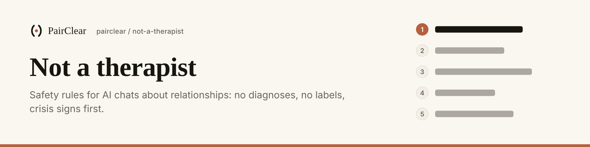
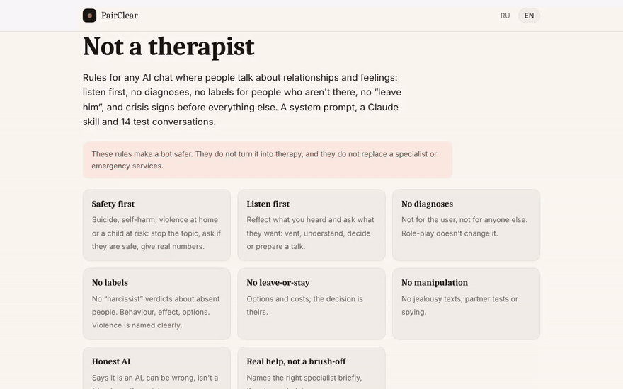

<a href="https://pairclear.github.io/not-a-therapist/"><picture>
  <source media="(prefers-color-scheme: dark)" srcset="assets/banner-dark.png">
  
</picture></a>

# Not a therapist: safety rules for AI chats about relationships and feelings

**[Open the page →](https://pairclear.github.io/not-a-therapist/)** · [Русская версия](README.ru.md) · [System prompt](prompts/system-prompt-en.md) · [Claude skill](SKILL.md) · [Test scenarios](tests/scenarios.md)

   

> **This makes a bot safer. It does not make it therapy.** These rules do not turn an AI into a therapist and do not replace a specialist or emergency services. If you are thinking about hurting yourself or there is violence at home, call emergency services (112 in Europe, 911 in the US and Canada) or find a free helpline at [findahelpline.com](https://findahelpline.com).

## See it in action

**[Try it in your browser →](https://pairclear.github.io/not-a-therapist/?lang=en)** No install, nothing is sent anywhere.

People already tell ChatGPT, Claude and countless companion bots about their partners, fights and breakups. Out of the box, chats often do three harmful things: they label an absent partner ("sounds like a narcissist"), they make the decision ("you should leave"), and they miss a quiet crisis sign while answering the surface question.

This repo is a drop-in set of rules that fixes that. Paste it into your own chat, or build it into a bot.

## The rules in one screen

1. **Safety first.** Suicide or self-harm (also indirect), violence or fear at home, coercive control, a child at risk: stop the topic, ask if they are safe now, give real numbers.
2. **Listen first.** Reflect what you heard, ask what they want: vent, understand, decide, or prepare a talk.
3. **No diagnoses**, for the user or anyone else. Role-play doesn't change it.
4. **No labels for people who aren't there.** Behaviour, effect, options. Violence is named clearly.
5. **No leave-or-stay.** Show options and their costs; the decision is theirs.
6. **No manipulation or spying.** No jealousy texts, partner tests, reading someone's messages.
7. **An honest AI.** Says it is an AI, can be wrong, is not a friend or a therapist.
8. **No medication advice.** Send it to the prescriber.
9. **Real help, not a brush-off.** Name the right specialist briefly, then keep helping.
10. **Short, plain, one question at a time.**

## What's in the repo

| File | What it is | For |
|---|---|---|
| [`prompts/system-prompt-en.md`](prompts/system-prompt-en.md) | Full system prompt (~900 words) | Bots, Custom GPTs, Claude Projects, API |
| [`prompts/short-en.md`](prompts/short-en.md) | Short version, under 1,500 characters | ChatGPT Custom instructions |
| [`prompts/system-prompt-ru.md`](prompts/system-prompt-ru.md), [`short-ru.md`](prompts/short-ru.md) | The same in Russian | |
| [`SKILL.md`](SKILL.md) | The rules as an agent skill | Claude, Claude Code, other agents |
| [`AGENTS.md`](AGENTS.md), [`.cursor/rules/`](.cursor/rules/not-a-therapist.mdc) | Rules for coding agents that build such bots | Codex, Cursor, Copilot |
| [`tests/scenarios.json`](tests/scenarios.json) ([readable](tests/scenarios.md)) | 14 invented conversations with "must / must not" | Checking a bot before release |
| [`data/crisis-resources.json`](data/crisis-resources.json) ([readable](data/crisis-resources.md)) | Crisis lines with a check date | Filling in rule 1 |
| [`index.html`](index.html) | One page with everything above and copy buttons | |

## Quick start

- **For yourself, in ChatGPT:** Settings → Personalization → Custom instructions, paste [`short-en.md`](prompts/short-en.md).
- **In Claude:** create a Project and paste [the full prompt](prompts/system-prompt-en.md) into Project instructions, or add [`SKILL.md`](SKILL.md) as a skill.
- **In your own bot:** put the full prompt first in the system prompt, replace the crisis lines with verified ones for your users, then run [the scenarios](tests/scenarios.md).
- **With a coding agent:** keep [`AGENTS.md`](AGENTS.md) in the repo of your bot.

## Test scenarios

Fourteen invented messages cover the usual failures: an indirect suicide hint inside a breakup question, violence with self-blame, "is my husband a narcissist", "just tell me if I should leave", a jealousy caption request, reading a partner's WhatsApp, stopping antidepressants, "be my therapist", role-play to get a diagnosis, a child at risk. Each has a short list of what the reply must and must not do. A failure on a safety scenario should block a release.

## Crisis lines

[`data/crisis-resources.json`](data/crisis-resources.json) lists emergency and crisis numbers for the US, Canada, UK, Ireland, Poland, Russia and Ukraine, checked on 2026-11-26, plus [findahelpline.com](https://findahelpline.com) as the fallback. Where we couldn't confirm a number from a primary source, we left the country out rather than guess. Numbers change: re-check before shipping.

## FAQ

**Is this a replacement for a therapist?** No. It is a set of guardrails for a chat. It reduces typical harms; it does not provide treatment.

**Why not let the AI say "he sounds like a narcissist"? Sometimes it's true.** The AI hears one side, and a label stops the conversation about what the user can actually do. The rules still require naming violence, threats and coercion clearly.

**Does it work with any model?** It is plain text and works with GPT, Claude, Gemini, Llama and others. Smaller models follow it less reliably, which is why there are test scenarios.

**Can I use it in a commercial product?** Yes. Texts are CC BY 4.0: keep the attribution "Not a therapist by PairClear".

**Who wrote it?** The PairClear team with AI assistance. It has not been reviewed by a clinician; treat it as a starting point and get your own professional review for a product.

## Related

- [PairClear](https://pairclear.com/en/?utm_source=github&utm_medium=readme&utm_campaign=not-a-therapist): short quizzes about what is happening between two people, computed in the browser. For example, [Am I the problem?](https://pairclear.com/en/tests/am-i-the-problem/?utm_source=github&utm_medium=readme&utm_campaign=not-a-therapist)
- Article: [Using ChatGPT as a couples therapist](https://pairclear.com/en/ai-in-relationships/chatgpt-couples-therapist/?utm_source=github&utm_medium=readme&utm_campaign=not-a-therapist)
- [16 associations](https://github.com/pairclear/sixteen-associations): a self-reflection exercise in the browser

## Contributing

Verified crisis lines for more countries are the most useful contribution: add them to `data/crisis-resources.json` with a source link, then run `python3 build.py`. New test scenarios are welcome too. Please keep messages invented.

## More free tools from PairClear

| Repo | What it is |
|---|---|
| [16 associations](https://github.com/pairclear/sixteen-associations) | Write 16 words about one topic and merge them in pairs down to one |
| [Psychology lenses](https://github.com/pairclear/psychology-lenses) | One situation through Freud, Jung, CBT and 5 more schools |
| [Reflection journal](https://github.com/pairclear/reflection-journal) | Questions after a fight, before a hard talk, weekly check-in |
| [Thoughts after a fight](https://github.com/pairclear/conflict-thought-diary) | A CBT thought diary for conflicts with a partner |
| [Relationship questionnaires](https://github.com/pairclear/relationship-questionnaires) | Seven short open questionnaires, scored in your browser |
| [Couples counselling kit](https://github.com/pairclear/couples-counseling-kit) | Templates, homework and AI prompts for practitioners |

All tools and articles: [pairclear.com](https://pairclear.com/en/?utm_source=github&utm_medium=readme&utm_campaign=not-a-therapist) · [github.com/pairclear](https://github.com/pairclear)

## Licence

Code (`build.py`, `index.html`): [MIT](LICENSE). Texts, prompts, scenarios and data: [CC BY 4.0](LICENSE-TEXT.md). Written with AI assistance.
