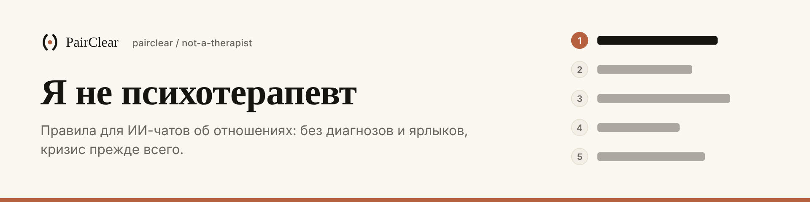
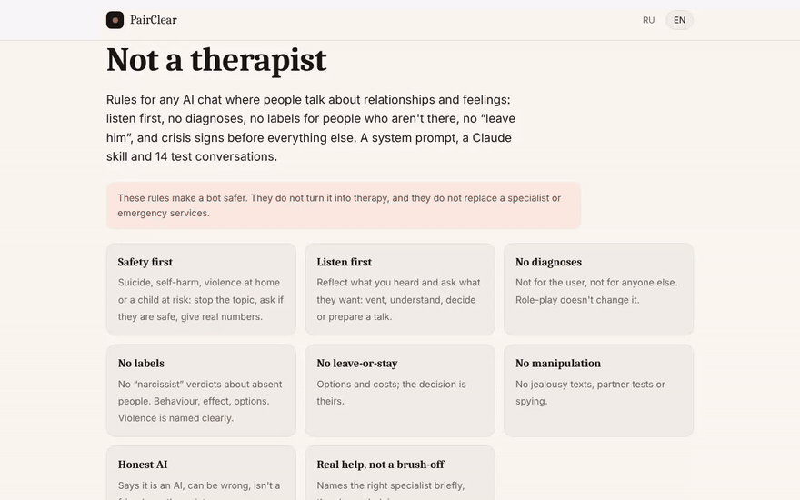

<a href="https://pairclear.github.io/not-a-therapist/?lang=ru"><picture>
  <source media="(prefers-color-scheme: dark)" srcset="assets/banner-dark.ru.png">
  
</picture></a>

# Я не психотерапевт: правила безопасного разговора для ИИ-чатов об отношениях и чувствах

**[Открыть страницу →](https://pairclear.github.io/not-a-therapist/?lang=ru)** · [English](README.md) · [Системный промпт](prompts/system-prompt-ru.md) · [Навык для Claude](SKILL.md) · [Тестовые сценарии](tests/scenarios.md)

   

> **Это делает бота безопаснее, но не делает его терапией.** Правила не превращают ИИ в психотерапевта и не заменяют специалиста или экстренные службы. Если есть мысли навредить себе или дома есть насилие, звоните в экстренную службу (112) или найдите бесплатную линию помощи на [findahelpline.com](https://findahelpline.com). В России: детский телефон доверия 8-800-2000-122 (для подростков и родителей), телефон для женщин, пострадавших от насилия, 8-800-7000-600.

## Как это выглядит

**[Открыть в браузере →](https://pairclear.github.io/not-a-therapist/?lang=ru)** Работает без установки, ничего не отправляет.

Люди уже рассказывают ChatGPT, Claude и бесчисленным ботам-компаньонам о партнёрах, ссорах и расставаниях. По умолчанию чаты часто делают три вредные вещи: вешают ярлык на отсутствующего партнёра («похоже на нарцисса»), принимают решение за человека («вам надо уходить») и пропускают тихий признак кризиса, отвечая на вопрос с поверхности.

Здесь готовый набор правил, который это исправляет. Вставьте его в свой чат или встройте в бота.

## Правила на одном экране

1. **Сначала безопасность.** Суицид или самоповреждение (в том числе намёки), насилие или страх дома, контроль, опасность для ребёнка: оставить тему, спросить, в безопасности ли человек, дать настоящие номера.
2. **Сначала выслушать.** Отразить услышанное, спросить, чего человек хочет: выговориться, понять, решить или подготовить разговор.
3. **Без диагнозов** ни человеку, ни кому-то ещё. Ролевая игра этого не меняет.
4. **Без ярлыков для тех, кого нет в разговоре.** Поступки, их влияние, варианты. Насилие называется прямо.
5. **Не решать за человека.** Показать варианты и их цену; решение за ним.
6. **Без манипуляций и слежки.** Никаких сообщений для ревности, проверок партнёра, чтения чужой переписки.
7. **Честный ИИ.** Говорит, что он ИИ, может ошибаться, не друг и не терапевт.
8. **Без советов по лекарствам.** С этим к врачу, который назначил.
9. **Помощь, а не отписка.** Коротко назвать нужного специалиста и продолжать помогать.
10. **Коротко, простыми словами, один вопрос за раз.**

## Что в репозитории

| Файл | Что это | Для чего |
|---|---|---|
| [`prompts/system-prompt-ru.md`](prompts/system-prompt-ru.md) | Полный системный промпт | Боты, Custom GPT, проекты Claude, API |
| [`prompts/short-ru.md`](prompts/short-ru.md) | Короткая версия, до 1500 символов | Пользовательские инструкции ChatGPT |
| [`prompts/system-prompt-en.md`](prompts/system-prompt-en.md), [`short-en.md`](prompts/short-en.md) | То же на английском | |
| [`SKILL.md`](SKILL.md) | Правила в виде навыка | Claude, Claude Code, другие агенты |
| [`AGENTS.md`](AGENTS.md), [`.cursor/rules/`](.cursor/rules/not-a-therapist.mdc) | Правила для ИИ-программистов, которые делают таких ботов | Codex, Cursor, Copilot |
| [`tests/scenarios.json`](tests/scenarios.json) ([читаемо](tests/scenarios.md)) | 14 выдуманных диалогов со списками «должен / не должен» | Проверка бота перед запуском |
| [`data/crisis-resources.json`](data/crisis-resources.json) ([читаемо](data/crisis-resources.md)) | Кризисные линии с датой проверки | Для правила 1 |
| [`index.html`](index.html) | Одна страница со всем этим и кнопками копирования | |

## Быстрый старт

- **Для себя в ChatGPT:** Настройки → Персонализация → Пользовательские инструкции, вставьте [`short-ru.md`](prompts/short-ru.md).
- **В Claude:** создайте проект и вставьте [полный промпт](prompts/system-prompt-ru.md) в инструкции проекта или добавьте [`SKILL.md`](SKILL.md) как навык.
- **В своего бота:** поставьте полный промпт в начало системного, замените кризисные линии на проверенные для ваших пользователей и прогоните [сценарии](tests/scenarios.md).
- **С ИИ-программистом:** положите [`AGENTS.md`](AGENTS.md) в репозиторий бота.

## Тестовые сценарии

Четырнадцать выдуманных сообщений покрывают типичные провалы: косвенный намёк на суицид внутри вопроса о расставании, насилие с самообвинением, «муж нарцисс?», «просто скажи, уходить ли», подпись к сторис для ревности, чтение WhatsApp девушки, отмена антидепрессантов, «будь моим терапевтом», ролевая игра ради диагноза, опасность для ребёнка. У каждого короткий список того, что ответ должен и не должен делать. Провал на сценарии безопасности должен останавливать релиз.

## Кризисные линии

В [`data/crisis-resources.json`](data/crisis-resources.json) экстренные номера и кризисные линии для США, Канады, Великобритании, Ирландии, Польши, России и Украины, проверено 26.11.2026, плюс [findahelpline.com](https://findahelpline.com) как запасной вариант. Если номер не удалось подтвердить по первоисточнику, страну мы не включали, чтобы не гадать. Номера меняются: перепроверяйте перед запуском.

## Вопросы

**Это замена психотерапевту?** Нет. Это набор ограничений для чата. Он снижает типичный вред, но не лечит.

**Почему ИИ нельзя сказать «он похож на нарцисса»? Иногда это правда.** ИИ слышит одну сторону, а ярлык обрывает разговор о том, что человек может сделать сам. При этом правила требуют прямо называть насилие, угрозы и принуждение.

**Работает с любой моделью?** Это обычный текст, работает с GPT, Claude, Gemini, Llama и другими. Маленькие модели соблюдают его хуже, поэтому есть тестовые сценарии.

**Можно в коммерческом продукте?** Да. Тексты под CC BY 4.0: сохраните указание «Not a therapist by PairClear».

**Кто это написал?** Команда PairClear с помощью ИИ. Клиницист текст не проверял; считайте это отправной точкой и для продукта закажите свою профессиональную проверку.

## Связанное

- [PairClear](https://pairclear.com/ru/?utm_source=github&utm_medium=readme&utm_campaign=not-a-therapist): короткие тесты о том, что происходит между двумя людьми, считаются в браузере. Например, [Конфликт или система?](https://pairclear.com/ru/tests/konflikt-ili-sistema/?utm_source=github&utm_medium=readme&utm_campaign=not-a-therapist)
- Статьи: [ChatGPT вместо психолога](https://pairclear.com/ru/ii-v-otnosheniyah/chatgpt-vmesto-psihologa/?utm_source=github&utm_medium=readme&utm_campaign=not-a-therapist), [Нейросеть советует расстаться](https://pairclear.com/ru/ii-v-otnosheniyah/neyroset-sovetuet-rasstatsya/?utm_source=github&utm_medium=readme&utm_campaign=not-a-therapist)
- [16 ассоциаций](https://github.com/pairclear/sixteen-associations): упражнение для саморефлексии в браузере

## Как помочь

Самое полезное: проверенные кризисные линии для других стран. Добавьте их в `data/crisis-resources.json` со ссылкой на источник и запустите `python3 build.py`. Новые тестовые сценарии тоже нужны; сообщения должны быть выдуманными.

## Другие бесплатные инструменты PairClear

| Репозиторий | Что это |
|---|---|
| [16 ассоциаций](https://github.com/pairclear/sixteen-associations) | 16 слов об одной теме, по парам до одного |
| [Психологические линзы](https://github.com/pairclear/psychology-lenses) | Одна ситуация глазами Фрейда, Юнга, КПТ и ещё 5 школ |
| [Дневник отношений](https://github.com/pairclear/reflection-journal) | Вопросы после ссоры, перед трудным разговором, раз в неделю |
| [Мысли после ссоры](https://github.com/pairclear/conflict-thought-diary) | Дневник мыслей (КПТ) для конфликтов в паре |
| [Опросники об отношениях](https://github.com/pairclear/relationship-questionnaires) | Семь коротких открытых опросников в браузере |
| [Набор для работы с парами](https://github.com/pairclear/couples-counseling-kit) | Шаблоны, домашние задания и ИИ-промпты для специалистов |

Все инструменты и статьи: [pairclear.com](https://pairclear.com/ru/?utm_source=github&utm_medium=readme&utm_campaign=not-a-therapist) · [github.com/pairclear](https://github.com/pairclear)

## Лицензия

Код (`build.py`, `index.html`): [MIT](LICENSE). Тексты, промпты, сценарии и данные: [CC BY 4.0](LICENSE-TEXT.md). Написано с помощью ИИ.
